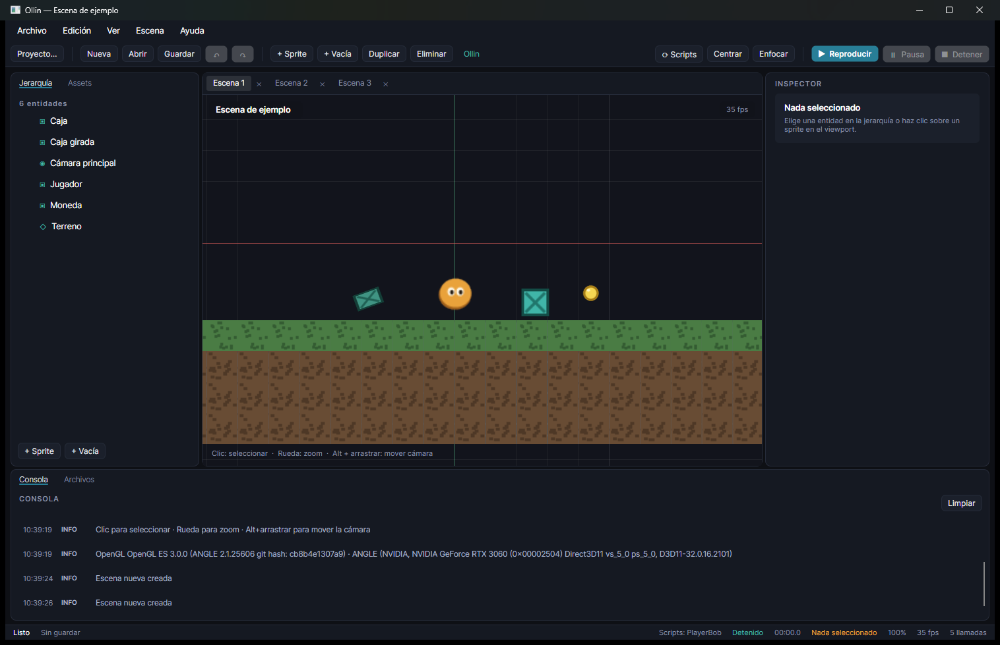

<p align="center">
  
</p>

# Ollin

**Motor de juego 2D y 2.5D, gratis y libre (MIT) para cualquier persona, con editor propio y scripting opcional en C#.**

> *Ollin* significa **movimiento** en náhuatl. El *Nahui Ollin* es el símbolo mexica del
> movimiento y el cambio.

Ollin es **gratis y de código abierto (MIT)**: puedes usarlo, modificarlo y distribuir tus juegos sin pagar ni pedir permiso. El objetivo es que **cualquier persona** pueda crear un juego 2D o 2.5D, programando o sin programar.

[](https://github.com/deadcodeMx/ollin/actions/workflows/ci.yml)




## Descargas

- **Última beta**: [Ollin-Setup-0.21.0-beta.exe](https://github.com/deadcodeMx/ollin/releases/latest)
- **Todas las versiones**: [Releases del proyecto](https://github.com/deadcodeMx/ollin/releases)
- **Guía completa de uso**: [docs/GUIA.md](docs/GUIA.md)

Cada versión del motor se publica como *release* con su instalador y sus notas. El
instalador copia el motor en `%LOCALAPPDATA%\Ollin`, crea accesos directos y añade
un desinstalador. Requiere **.NET 8 Desktop Runtime**.

## ¿Qué es Ollin?

Ollin es un motor de juego escrito desde cero en **C#/.NET 8**, con su propio editor
gráfico. No envuelve otro motor: el renderizado, la escena, el bucle de juego, el
historial y el compilador de scripts son código propio del proyecto.

La idea es sencilla: **abrir el editor, montar una escena, escribir un script en C# y
darle a Reproducir**, sin salir de la misma ventana.

- Editor con tema oscuro propio (jade + ámbar) construido con **Avalonia**.
- Viewport con **OpenGL ES 3.0** real (sprite batching, cuadrícula, gizmos).
- Escenas guardadas en **JSON legible** y versionables.
- Assets con rutas relativas: el proyecto se puede mover de carpeta.
- Deshacer/rehacer con historial de estados.
- Scripts en **C# compilados con Roslyn** en memoria, con recarga desde el editor.

## Enfoque

Ollin es un **motor 2D generalista**: sirve igual para plataformas, aventura, RPG,
puzles, acción top-down, terror, prototipos o experimentos personales. No impone un
género ni un estilo: la escena, los componentes y los scripts son las piezas con las
que armas el juego que quieras.

El objetivo es que una sola persona pueda terminar proyectos pequeños y variados, con
herramientas cómodas, arranque rápido y alcance contenido. El plan completo está en
[docs/ROADMAP.md](docs/ROADMAP.md) e incluye un puente 2.5D antes del 3D.

## Estado del proyecto

| Etapa | Contenido | Estado |
| --- | --- | --- |
| 0 | Cimientos: stack, entorno, solución | ✅ |
| 1 | Editor: escena, jerarquía, inspector, viewport, cámara, JSON | ✅ |
| 2 | Runtime (Play/Pausa/Detener), assets, gizmos, deshacer/rehacer | ✅ |
| 3 | Scripting en C# con Roslyn, `Input`/`Time` y recarga en caliente | ✅ |
| 4 | Animación, tilemaps, física, audio, prefabs, proyectos y herramientas | ✅ |
| 5 | Herramientas de juego 2D: luces, triggers, diálogos, inventario, IA, día/noche | ✅ |
| 6 | 2.5D: cámara FPS, cajas 3D, niebla y audio posicional | 🚧 núcleo jugable |
| 6 | 2.5D: sprites en espacio 3D con cámara en primera persona | ⏳ |
| 7 | 3D: mallas glTF, luces y sombras, física, navmesh, editor 3D | ⏳ |
| 8 | Producto: build, guardado, opciones, perfilador, localización | ⏳ |

Detalle completo en [docs/ROADMAP.md](docs/ROADMAP.md).

## Características actuales

| Área | Qué hace |
| --- | --- |
| Escena | Entidades con jerarquía, transformación 2D y componentes serializables |
| Render | Sprite batch OpenGL con tinte, rotación, escala, orden de dibujo y texturas |
| Cámara | Ortográfica con paneo, zoom anclado al cursor y encuadre |
| Edición | Inspector en vivo, selección por árbol y por clic, gizmos mover/rotar/escalar |
| Historial | Deshacer/rehacer con agrupación de ediciones continuas (60 pasos) |
| Assets | Lista con miniaturas, importar PNG/JPG/BMP y asignar al sprite |
| Juego | Reproducir, pausar y detener restaurando la escena exactamente |
| Scripts | Compilación en memoria, ciclo de vida, Input/Time, recarga en caliente y errores con línea |
| Animación | Hojas de sprites con cuadros, FPS, bucle y recorte por cuadro |
| Tilemaps | Rejilla con tileset, pintado con el ratón en el viewport |
| Física | Cajas de colisión, cuerpos con velocidad, gravedad y disparadores con avisos a scripts |
| Rutinas | StartCoroutine + WaitForSeconds para secuencias |
| Depuración | DebugDraw.Line/Rect sobre el viewport |
| Consola | Mensajes del motor con niveles (info, aviso, error) |

## Stack

| Pieza | Tecnología |
| --- | --- |
| Lenguaje | C# 12 / .NET 8 |
| GUI | [Avalonia](https://avaloniaui.net/) 11.3 |
| Render | OpenGL ES 3.0 vía [Silk.NET](https://github.com/dotnet/Silk.NET) (ANGLE en Windows) |
| Scripts | [Roslyn](https://github.com/dotnet/roslyn) (`Microsoft.CodeAnalysis.CSharp`) |
| Serialización | `System.Text.Json` con discriminador `$type` |
| Pruebas | xUnit (con ejecutor en proceso incluido) |

## Empezar

### Requisitos

- **Windows 10/11** (el código está preparado para portarse a Linux/macOS).
- **.NET 8 SDK** ([descarga](https://dotnet.microsoft.com/download/dotnet/8.0)).
- GPU con soporte de OpenGL ES 3.0.

### Ejecutar el editor

```powershell
git clone https://github.com/deadcodeMx/ollin.git
cd ollin
dotnet run --project src/Ollin.Editor
```

O abre `Ollin.sln` en Visual Studio 2022 / Rider y ejecuta **Ollin.Editor**.

### Ejecutar las pruebas

```powershell
dotnet test tests/Ollin.Tests
```

Si el host de VSTest no arranca en tu entorno, el mismo proyecto funciona como
ejecutor en proceso:

```powershell
dotnet run --project tests/Ollin.Tests
```

## Controles del editor

| Entrada | Acción |
| --- | --- |
| Clic | Seleccionar sprite en el viewport |
| Arrastrar el sprite | Mover (con `Ctrl`, pasos de 0.25) |
| Arrastrar un mango de esquina | Escalar (con `Ctrl`, pasos de 0.1) |
| Arrastrar el rombo superior | Rotar (con `Ctrl`, pasos de 15°) |
| Rueda | Zoom anclado al cursor |
| `Alt` + arrastrar, o botón central | Mover la cámara |
| `F5` / `F6` | Reproducir-detener / pausar |
| Teclado durante Play | Lo recibe el juego (`Input`), no el editor |
| `Ctrl + Z` / `Ctrl + Y` | Deshacer / rehacer |
| `Ctrl + N` / `Ctrl + O` / `Ctrl + S` | Nueva / abrir / guardar escena |
| `Supr` | Eliminar entidad |
| `F` / `Inicio` | Enfocar selección / centrar cámara |

## Estructura del repositorio

```
src/
  Ollin.Core/        Modelo de escena, componentes, cámara, historial, serialización
  Ollin.Rendering/   Renderer 2D sobre OpenGL ES (sprite batch, cuadrícula, hit-test)
  Ollin.Runtime/     Bucle de juego: reproducción, pausa, delta time y restauración
  Ollin.Scripting/   Compilación de scripts con Roslyn y API pública de scripting
  Ollin.Editor/      Aplicación Avalonia: proyectos, documentos, viewport, inspector, consola
tools/
  Ollin.Setup/       Instalador de Windows (copia, accesos directos y desinstalador)
tests/
  Ollin.Tests/       Pruebas del núcleo, del runtime y del compilador de scripts
assets/sprites/      Texturas de ejemplo (héroe, caja, moneda, suelo)
scripts/             Scripts de usuario en C# (se compilan en memoria)
docs/                Arquitectura, roadmap y guía de publicación en GitHub
```

## El editor

- **Proyectos independientes**: `Archivo → Nuevo proyecto…` crea una carpeta con
  `scenes/`, `scripts/`, `assets/` y `prefabs/`, un `project.ollin`, una escena y un
  script iniciales. `Abrir proyecto…` carga cualquiera existente y recuerda el último.
- **Pestañas de documentos**: varias escenas y scripts abiertos conviven en el área
  central. Cada escena conserva cámara, selección e historial propios.
- **Editor de código con resaltado C#**: numeración de líneas, colores para palabras
  clave, tipos, cadenas, comentarios y números (AvaloniaEdit con tema oscuro).
- **Editor de scripts integrado**: abre un `.cs` desde el dock *Archivos* o con
  `Edición → Abrir script de la selección`. `Ctrl+S` guarda y dispara la recarga.
- **Dock inferior con pestañas**: *Consola* y *Archivos* (explorador del proyecto;
  doble clic abre scripts, escenas y asigna texturas).
- **Inspector por pestañas**: Entidad, Visual, Mundo, Tilemap y Cámara.
- **Línea de comandos**: `Ollin.Editor.exe --project <ruta> [--script <archivo.cs>]`.

## Audio, prefabs y herramientas (etapa 4)

- **Audio 2D** con NAudio: `AudioSource` por entidad (clip, volumen, bucle, música,
  fundido) y API para scripts: `Audio.Play(...)`, `Audio.Music(...)`, `Audio.StopAll()`.
  Incluye sonidos de ejemplo en `assets/audio/`.
- **Prefabs** `*.prefab.json`: guarda la entidad seleccionada y instánciala con doble
  clic desde el explorador de archivos.
- **Copiar y pegar** entidades con `Ctrl+C` / `Ctrl+V` (nombre y posición ajustados).
- **Buscador en la jerarquía** para filtrar entidades por nombre.
- **Plantillas de proyecto**: Vacío, Plataformas y Terror, con escena y script inicial
  propios.
- **Colisión por celda** en los tilemaps (casilla *Colisiona*) y cuerpos cinemáticos.
- **Diálogos e interacción**: dialogs/*.json, componente Interactable, aviso con E
  y etiquetas de entidad.
- **Luces 2D y atmósfera**: luces puntuales y conos, ambiente por cámara, viñeta,
  paralaje y cámara con seguimiento.
- **Lanzador de proyectos**, **3 temas** (oscuro, claro y Ollin), **blueprints** con
  jerarquía, ventana de juego aparte y **proyecto de tutorial**.
- **Exportar juego**: un único `.exe` + `game.pak` cifrado con escenas, assets y
  scripts compilados; pantalla de inicio y marca de agua opcionales.
- **Modo 2.5D**: cámara y controlador en primera persona, paredes de caja, niebla,
  luces por objeto y audio posicional; plantilla «2.5D (pasillo)».

## Edición cómoda (estilo Unity/Godot)

- **Arrastrar y soltar**: lleva un `.cs` desde *Archivos* a una entidad (jerarquía o
  viewport) para enlazarlo; suelta un `*.prefab.json` para instanciarlo donde quieras.
- **Menú contextual de entidad**: crear hijo, añadir componente, duplicar, enfocar,
  guardar como prefab y eliminar.
- **Componentes desde el inspector**: botón *+ Añadir componente* y *Quitar script*.
- **Eliminar archivos** con clic derecho en *Archivos* (pide confirmación).
- **Doble clic en la jerarquía** centra la cámara en la entidad.
- **Autocompletado C#**: `Ctrl+Espacio` y automático tras escribir `.`, con palabras
  clave, tipos, API de Ollin, entidades y scripts del proyecto.

## Scripts en C#

Los scripts viven en `scripts/` y se compilan **en memoria con Roslyn** al abrir el
proyecto y al guardar cualquier `.cs`. Si se guardan **mientras se reproduce**, se aplica
una **recarga en caliente**: la partida no se detiene y se conserva el estado de los
campos compatibles.

```csharp
using System;
using System.Numerics;
using Ollin.Core.Input;
using Ollin.Scripting;

public sealed class PlayerBob : OllinScript
{
    private Vector2 _origin;
    private float _time;
    private float _horizontal;

    public override void OnStart() => _origin = Entity.Transform.Position;

    public override void OnUpdate(float deltaTime)
    {
        _time += deltaTime;

        var direction = 0f;
        if (Input.GetKey(KeyCode.A)) direction -= 1f;
        if (Input.GetKey(KeyCode.D)) direction += 1f;

        _horizontal += direction * 2.5f * Time.DeltaTime;

        Entity.Transform.Position = _origin + new Vector2(_horizontal, MathF.Sin(_time * 2.2f) * 0.28f);
    }

    public override void OnDestroy() => Entity.Transform.Position = _origin;
}
```

- **Ciclo de vida:** `OnStart`, `OnUpdate(deltaTime)`, `OnReload` (tras una recarga en
  caliente) y `OnDestroy`.
- **Entrada:** `Input.GetKey`, `GetKeyDown`, `GetKeyUp`, botones del ratón,
  `MousePosition` (mundo) y `MouseScreenPosition` (píxeles).
- **Tiempo:** `Time.DeltaTime`, `Time.Elapsed` y `Time.Frame`.
- **API:** `Entity` (con `Transform`), `Scene`, `Debug`/`Warn`/`Error` hacia la consola.
- **Enlazar:** en el inspector, sección *SCRIPT* (archivo + clase) o el botón
  *Crear script para esta entidad*, que genera la plantilla.
- **Errores:** aparecen en la consola con archivo, línea y código (`CS0029`…).

**Recarga en caliente.** Al guardar un script durante la reproducción, el runtime crea
las nuevas instancias, copia los campos compatibles (números, cadenas, vectores,
enumeraciones) y llama a `OnReload`. Las referencias a tipos definidos por el propio
script no se conservan porque el ensamblado se recompila.

## Beta instalable

La versión de prueba se empaqueta como instalador de Windows:

```
dist/installer/Ollin-Setup.exe
```

Instala en `%LOCALAPPDATA%\Ollin`, crea accesos directos y añade el desinstalador.
Instrucciones, requisitos y cómo regenerarla en [docs/BETA.md](docs/BETA.md).

## Formato de escena

Las escenas se guardan como JSON legible (`.ollin.json`) con versión de formato y
discriminador de tipo por componente:

```json
{
  "formatVersion": 1,
  "engine": "Ollin",
  "scene": {
    "name": "Escena de ejemplo",
    "entities": [
      {
        "name": "Jugador",
        "transform": { "position": [0, -1.6], "rotation": 0, "scale": [1, 1] },
        "components": [
          { "$type": "sprite", "texturePath": "assets/sprites/hero.png", "size": [1.3, 1.3] },
          { "$type": "script", "scriptPath": "scripts/PlayerBob.cs", "className": "PlayerBob" }
        ]
      }
    ]
  }
}
```

## Arquitectura

El editor y el runtime comparten proceso y modelo de escena. La GUI es Avalonia y el
viewport se dibuja con OpenGL embebido en la ventana.

```
Ollin.Editor ──▶ Ollin.Rendering ──▶ Ollin.Core
     │                                  ▲
     └────────▶ Ollin.Runtime ──────────┤
                Ollin.Scripting ────────┘
```

Más detalle (capas, coordenadas, flujo de un cuadro, cómo añadir componentes) en
[docs/ARQUITECTURA.md](docs/ARQUITECTURA.md).

## Contribuir

Ollin es un **proyecto personal**: no se buscan contribuciones externas ni se mantiene
como motor para terceros. Si algo te sirve o quieres comentar una idea, abre un *issue*;
las sugerencias son bienvenidas, pero el rumbo lo marca el desarrollo de mis propios
juegos. Las normas de convivencia están en [CODE_OF_CONDUCT.md](CODE_OF_CONDUCT.md).

## Licencia

[MIT](LICENSE) © 2026 DeadCodeMx.

---

## English summary

**Ollin** is a from-scratch 2D game engine and editor written in C#/.NET 8, with an
Avalonia UI, an OpenGL sprite renderer, JSON scenes, transform gizmos, undo/redo and
runtime C# scripting through Roslyn. The editor compiles the scripts in memory, binds
them to entities and reports errors with file and line. Build with `dotnet run --project
src/Ollin.Editor`.
